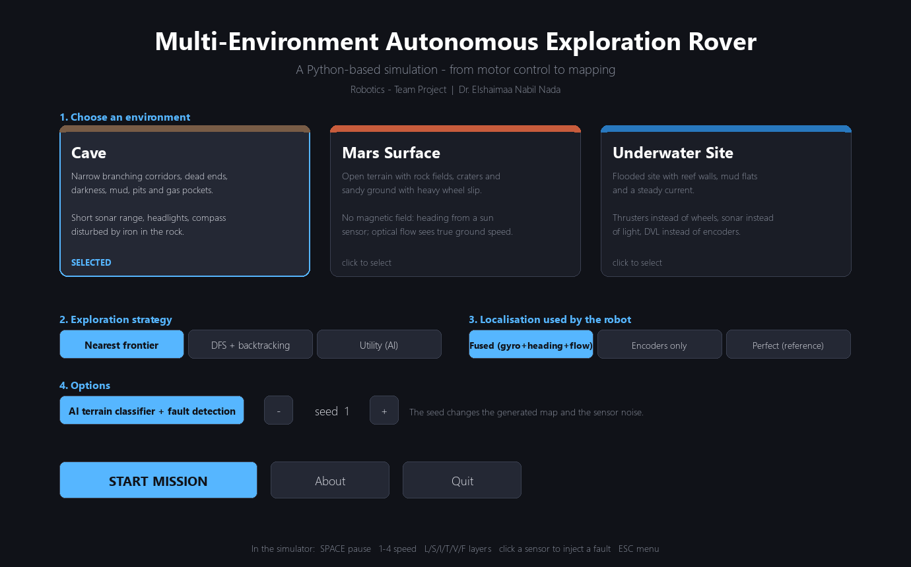
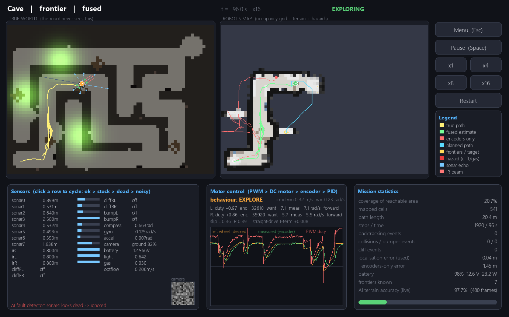
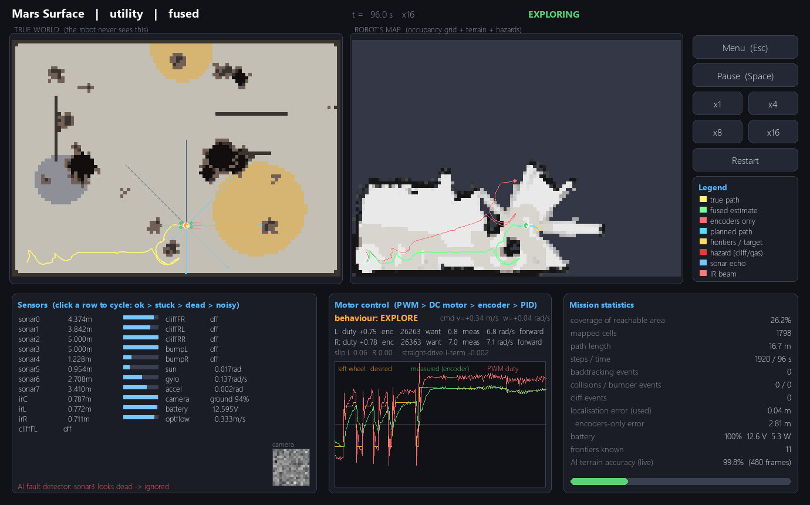
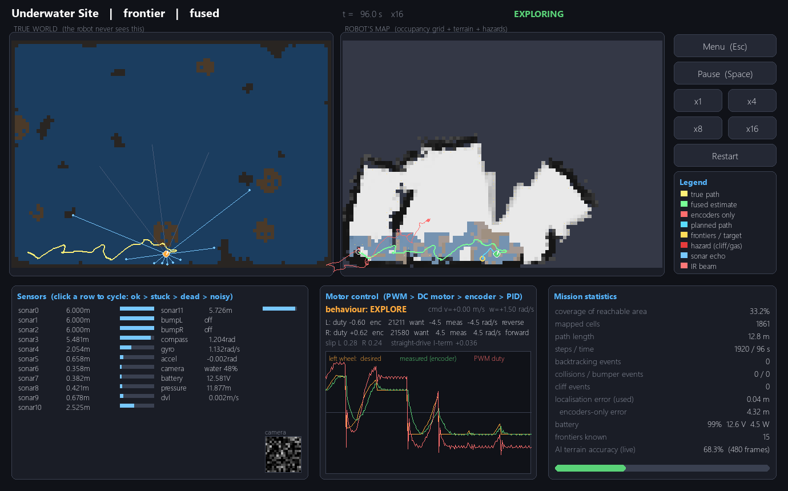
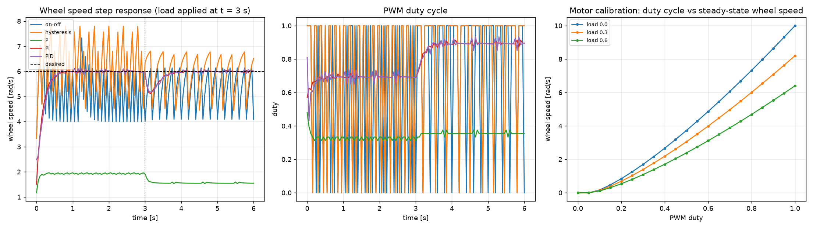

# Multi-Environment Autonomous Exploration Rover

A Python simulation of an autonomous exploration rover, built **from the actuator
and sensor level up** — DC motors, PWM, encoders, PID, a full on-board sensor
suite — to localisation, mapping, exploration and AI terrain classification.
One robot, three selectable environments: **cave**, **Mars surface**,
**underwater site**. Each environment is only a configuration (map generator,
terrain, sensor suite, noise, slip, current); the robot's control, estimation
and decision code never changes.

Robotics course — team project, supervised by **Dr. Elshaimaa Nabil Nada**.
Full proposal: [docs/Task1_v2.md](docs/Task1_v2.md). Design notes and sensor
placement: [docs/DESIGN.md](docs/DESIGN.md).

## Quick start

```bash
python -m venv .venv
.venv\Scripts\activate            # Windows   (source .venv/bin/activate on Linux/macOS)
pip install -r requirements.txt
python main.py
```

Pick an environment, a strategy and a localisation mode, press **START MISSION**.
In the simulator: `SPACE` pause · `1–4` speed ×1/×4/×8/×16 · `S` sonar rays ·
`I` IR beams · `T` terrain layer · `V` visited cells · `F` frontiers ·
`L` true path · `H` headlights · **click any sensor row to inject a fault**
(ok → stuck → dead → noisy) · `ESC` menu.

> Python 3.15 + `pygame-ce` is what we tested. On Windows 11 with *Smart App
> Control* on, the compiled parts of matplotlib / scikit-learn may be blocked;
> turn it off or use Python 3.12.

## Screenshots

| Start menu | Live simulator (cave) |
|---|---|
|  |  |
| **Mars** (utility explorer, AI fault detector on) | **Underwater** (DVL, current, 12-sonar ring) |
|  |  |

Left panel: the true world the robot never sees (sonar cones, IR beams, true
path). Right panel: the robot's own map (occupancy + terrain + hazards, fused
estimate in green, encoders-only estimate in red, planned path, frontiers).
Below: every sensor reading live, the PWM/encoder/PID loop of the left wheel,
and the mission statistics.



## What is simulated

| Layer | What the code does | Course topic |
|---|---|---|
| **Actuators** (`sim/robot/motor.py`) | Two DC motors behind an H-bridge; PWM duty → non-linear effective voltage with a static-friction dead band; first-order mechanical response; load from terrain; a `calibration_table()` that measures duty → speed | Actuators 1 & 2 |
| **Encoders** (`encoder.py`) | 16-tick two-phase incremental encoder on the motor shaft (×30 gearbox = 480 ticks/wheel rev), direction from phase order, speed from tick delta (quantised) | Sensors 1 |
| **Control** (`control.py`, `drive.py`) | On-off, hysteresis, P, PI, PD, PID in the lecture's incremental discrete form; a PID velocity loop per wheel; an I-controller on the encoder *position* difference so the differential drive goes straight; wheel slip the encoders cannot see | Control |
| **Sensors** (`sim/sensors/`) | Sonar ring (cone, specular loss, cross-talk, time-of-flight), Sharp-style IR PSDs (non-linear, lookup-table calibration, minimum-range fold-back), IR cliff switches (front, side, rear), bumpers, compass with local disturbance, sun sensor, gyro with bias, accelerometer/inclinometer, camera, optical flow / DVL, battery, light, gas, pressure. Analog sensors pass a modelled 10-bit **A/D converter**. Every sensor can be faulted at run time. | Sensors 1 & 2 |
| **Localisation** (`estimation.py`) | Dead reckoning from the encoders (drifts); fused estimate: gyro integrated and corrected by compass/sun (complementary filter, bias learned while stationary) + ground speed from optical flow / DVL | Sensors 2 |
| **Mapping** (`mapping.py`) | Log-odds occupancy grid (one echo never makes a cell occupied), terrain-cost layer from the AI, hazard layer from the cliff sensors | Navigation |
| **Behaviour** (`behaviors.py`) | Subsumption: `STOP > ESCAPE (bumper) > CLIFF > SLOPE > SCAN > AVOID (with hysteresis) > HOME (battery) > EXPLORE > WANDER` | Robot Behaviour |
| **Planning** (`planning.py`) | A* on an inflated cost map (configuration space + proximity penalty + terrain cost); nearest-frontier vs DFS-with-backtracking exploration; return to start when the battery only just suffices | Navigation / decision |
| **AI** (`sim/ai/`) | Random-Forest terrain classifier on 16×16 camera patches → planner cost map; sensor fault detector (stuck / dead / noisy) that drops a bad sensor; utility-based frontier selection (information gain / cost − hazard − battery) | — |
| **Environments** (`config.py`, `world.py`) | Cave: maze corridors, chambers, mud, pits against the walls, gas pockets, darkness. Mars: rock fields, craters with rims and slopes, sand (25 % slip), bedrock, ridges. Underwater: cellular-automata reef, mud flats, a constant current with noise. | — |

## Experiments (headless)

```bash
python -m sim.experiments.pid_demo                       # step responses of on-off/hysteresis/P/PI/PID + calibration curve
python -m sim.experiments.run_batch --seeds 10           # frontier vs DFS vs utility, every environment
python -m sim.experiments.run_batch --localisation       # fused vs encoders-only vs perfect
python -m sim.experiments.run_batch --ablation           # switch each sensor off and measure the damage
```

Each batch writes `results/<name>.csv` plus `<name>_summary.png` (coverage,
path length, backtracking, bumps, localisation error, energy) and
`<name>_coverage.png` (coverage over time, mean ± std over seeds).

## Tests

```bash
pytest
```

41 tests cover the motor calibration curve, encoder direction, PID steady-state
error, driving straight with mismatched motors, world connectivity, every
sensor's physics and faults, dead reckoning vs fusion, occupancy-grid
precision, A*, frontier detection, mission runs in all environments,
subsumption priorities, return-home, the terrain classifier and the fault detector.

## Layout

```
main.py                 entry point (Pygame app)
sim/config.py           environment configurations (the only thing that changes per environment)
sim/core.py             Pose, angles, terrain table
sim/world.py            true world + generators (cave / mars / underwater)
sim/robot/              motor, encoder, control, differential drive, robot body + battery
sim/sensors/            sensor base (classification, ADC, faults), range sensors, internal sensors, camera, suite
sim/estimation.py       dead reckoning, heading fusion
sim/mapping.py          occupancy grid + mapper
sim/planning.py         cost map, A*, frontiers, Frontier/DFS explorers
sim/behaviors.py        subsumption layers + arbiter
sim/mission.py          one run: wires everything, metrics
sim/ai/                 terrain classifier, fault detector, utility explorer, brain
sim/ui/                 menu, About, live simulator
sim/experiments/        batch runner, plots, PID demo
tests/                  pytest suite
docs/                   proposal (Task 1) and design notes
```
