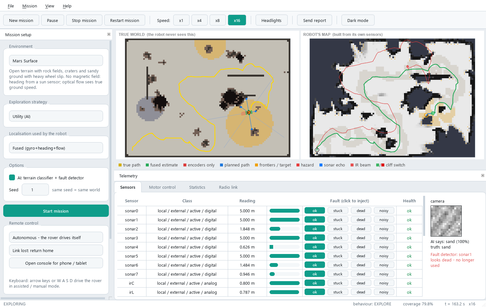
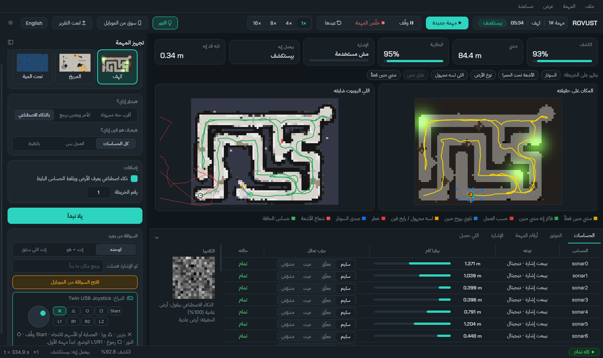
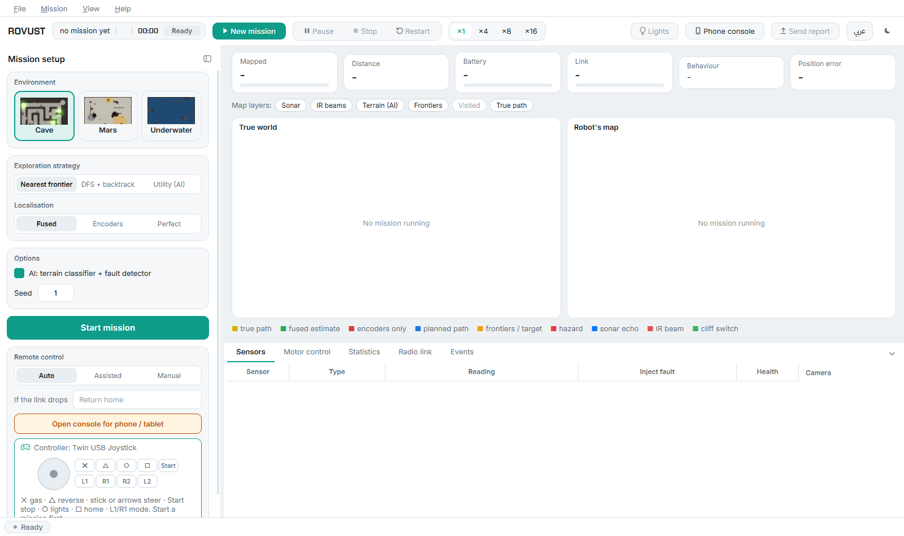
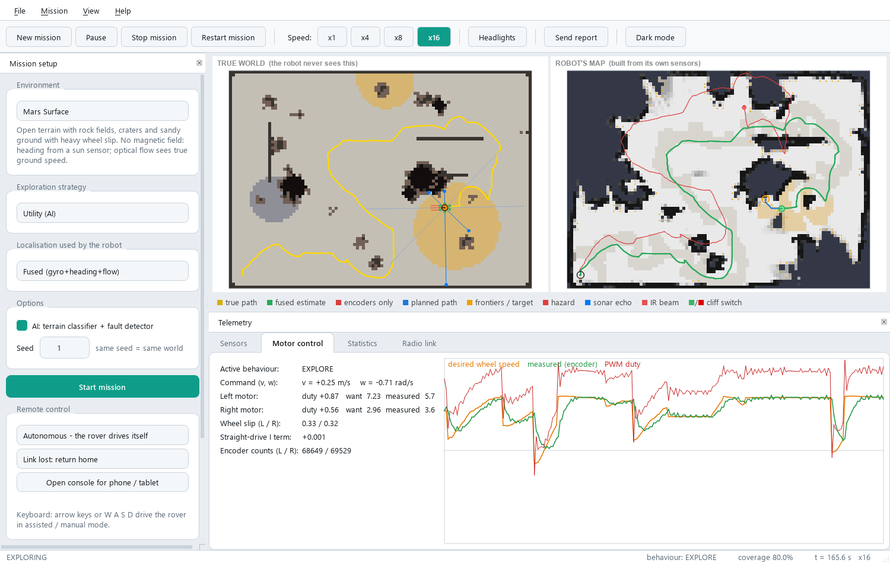
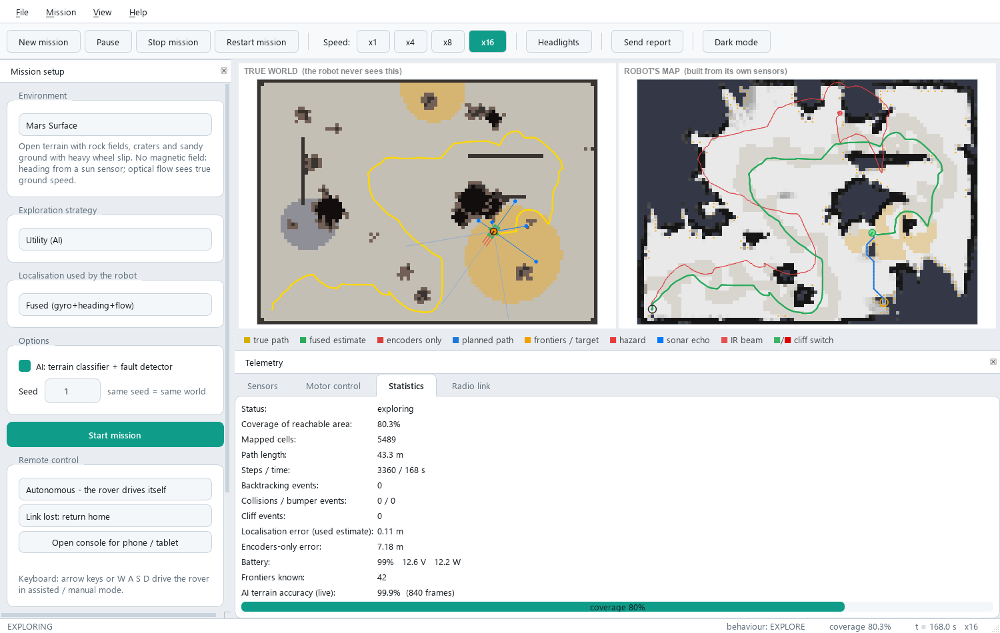
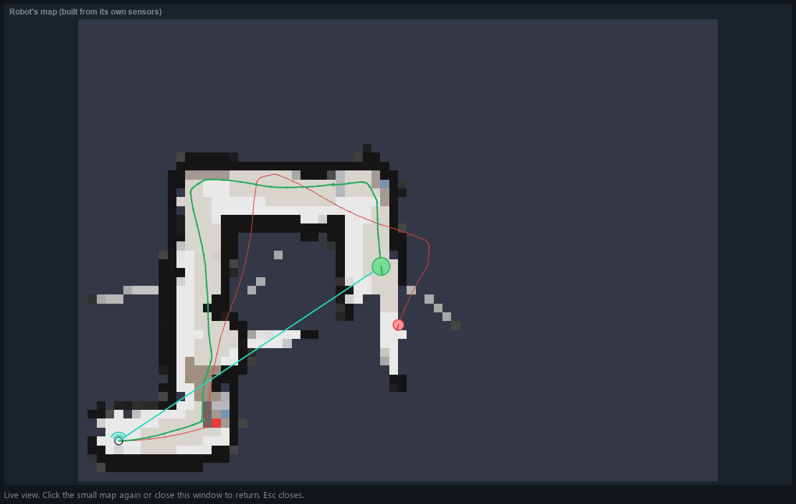
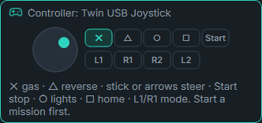
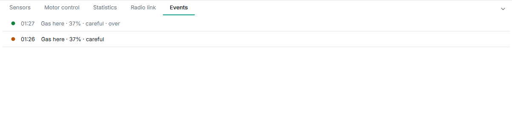
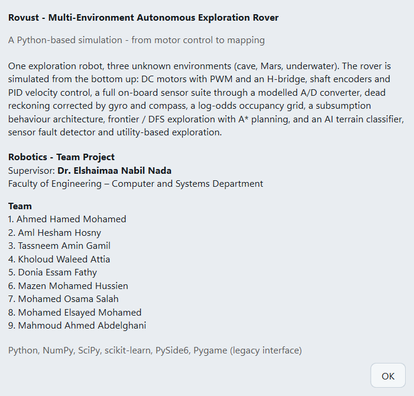

<p align="center">
  
</p>

<h1 align="center">Rovust</h1>
<p align="center"><b>Multi-Environment Autonomous Exploration Rover</b><br>
A Python simulation of an exploration rover, from motor control to mapping and decision making.</p>

<p align="center">
  
  
  
  
</p>

<p align="center">
  
</p>

Rovust is dropped into a place it has never seen, with no map and no GPS, and has
to explore it on its own: drive, sense, avoid walls and pits, build a map, decide
where to go next and return before the battery runs out. The robot is simulated
from the actuator level up (DC motors, PWM, encoders, PID, a full sensor suite),
and the same code runs unchanged in a cave, on Mars and under water.

## Overview

- **Three environments, one robot.** Cave, Mars and underwater differ only in
  configuration: terrain, sensor suite, noise, radio link.
- **Actuators and control.** Two DC motors behind an H-bridge with PWM, 480-tick
  incremental encoders, the lecture's discrete PID per wheel and a
  straight-driving controller.
- **Sensors with physics and faults.** Sonar ring (cone, specular loss,
  cross-talk), infrared with a calibrated lookup table, six cliff switches,
  bumpers, gyro with bias, compass or sun sensor, camera, optical flow or DVL,
  battery, light, gas and pressure, all through a 10-bit ADC. Any sensor can be
  broken at run time.
- **Localisation and mapping.** Dead reckoning drifts by metres; the fused
  estimate (gyro, absolute heading, ground speed) stays within centimetres. The
  map is a log-odds occupancy grid with terrain and hazard layers.
- **Behaviour and planning.** A subsumption architecture (stop, escape, cliff,
  slope, avoid, operator, home, explore), A* on an inflated cost map, and three
  exploration strategies: nearest frontier, DFS with backtracking, utility.
- **AI.** A random-forest terrain classifier feeds the planner's cost map; a
  statistical fault detector drops sensors that go bad.
- **Remote control.** Assisted or manual driving from a phone or tablet (scan
  a QR code), the keyboard or a game controller, over a simulated radio link
  that weakens with distance and walls; when the link is lost the rover drives
  itself back into range.
- **Game controller.** Any USB or Bluetooth pad, on the desktop and on the
  phone, laid out like a driving game: ✕ gas, △ reverse, stick or arrows steer,
  Start stops; the stick alone points where to go.
- **Desktop application** (Qt) in English and Egyptian Arabic (right-to-left),
  light and dark: live numbers, the two maps, sensors with fault injection, the
  motor control loop, the radio link, one calm alert at a time with an event log,
  a built-in user guide in both languages, and mission reports uploaded to the
  team's shared Drive folder.

## Screenshots

| Cave, utility explorer | Driven from a phone: QR code, radio link |
|---|---|
|  |  |
| Egyptian Arabic, right to left | Before the first mission |
|  |  |
| Motor control: PWM, motor, encoder, PID | Statistics |
|  |  |

| Tablet console | Phone console | Mission report |
|---|---|---|
|  |  |  |

<details>
<summary>More: map pop-up, mission over, controller, events, user guide, about</summary>

| Large map view | Mission over |
|---|---|
|  |  |
| Game controller card (✕ held, stick pushed) | Events tab |
|  |  |
| User guide (F1) | About |
|  |  |
</details>

## Quick start

**Windows, no tools needed:** on the repository page click **Code**, then
**Download ZIP**. Extract the folder anywhere short (for example `C:\Rovust`)
and double-click `setup.bat` inside it. It installs Python if needed, creates
the virtual environment, installs the dependencies, puts a Rovust shortcut on the
desktop and in the project folder, and starts the program. Run it again later to update the dependencies
(a copy cloned with git is also pulled to the latest version).

The repository is private: accept the collaborator invitation first, and sign
in to GitHub if git asks when cloning.

**Any platform:**

```bash
git clone https://github.com/buggYateer/rovust.git
cd rovust
python -m venv .venv && .venv\Scripts\activate     # source .venv/bin/activate on Linux/macOS
pip install -r requirements.txt
python main.py
```

Pick an environment, a strategy and a localisation mode, then **Start mission**
(or **New mission** in the header). Buttons that cannot act yet are greyed out.

| Key | Does | Key | Does |
|---|---|---|---|
| `Ctrl+N` | new mission | `R` | restart, same settings |
| `Space` | pause / resume | `Ctrl+.` | stop the mission |
| `1` `2` `3` `4` | speed ×1 ×4 ×8 ×16 | `H` | headlights |
| `Ctrl+S` | send report | `Ctrl+L` | English / عربي |
| `Ctrl+D` | dark mode | `F1` | user guide |
| arrows / `W A S D` | drive (Assisted, Manual) | | |

To drive from a phone, choose *Assisted* or *Manual* under **Remote control**,
press **Phone console** and scan the QR code that appears in the side panel (or
open the address in the phone's browser on the same Wi-Fi).

**Game controller** (USB dongle or Bluetooth; needs the optional `pygame-ce`,
installed by `setup.bat`):

| PlayStation (Xbox) | Does |
|---|---|
| ✕ (A) held | gas: forward, the left stick or the arrows steer |
| △ (Y) held | reverse, the left stick or the arrows steer |
| left stick or arrows alone | point-to-go: push where the rover should go; circle the stick to spin in place |
| R2 / L2 + right stick | analog driving |
| Start | stop |
| ○ (B) · □ (X) · L1 / R1 | headlights · return home · change mode | Reports are saved under `reports/` and
uploaded to the team's Drive folder when the bridge is configured
([docs/DRIVE_REPORTS.md](docs/DRIVE_REPORTS.md)).

> Requires Python 3.12 or newer. Windows 11 with *Smart App Control* on may
> block compiled packages. Teammates using Claude Code can paste the prompt in
> [docs/SETUP_WITH_CLAUDE.md](docs/SETUP_WITH_CLAUDE.md).

## Course mapping

Lecture by lecture (CSE442, lectures 1–8), with likely discussion questions, in the
[team guide](docs/team_guide_ar.html#course), section 24.

| Course topic | In Rovust |
|---|---|
| Actuators, PWM, H-bridge | `sim/robot/motor.py`: non-linear duty to speed, load, calibration table |
| Encoders, A/D conversion | `sim/robot/encoder.py`, `sim/sensors/base.py`: 2-phase encoder, 10-bit ADC |
| Control (on-off, PID) | `sim/robot/control.py`, `drive.py`: discrete PID, driving straight; `experiments/pid_demo.py` |
| Sensor types and placement | `sim/sensors/`: classification tags, physics, faults; [docs/DESIGN.md](docs/DESIGN.md) |
| Robot behaviour, subsumption | `sim/behaviors.py`: prioritised layers, operator in the loop |
| Navigation, mapping, planning | `sim/estimation.py`, `mapping.py`, `planning.py` |
| Communication | `sim/comms.py`, `sim/teleop/`: radio link model, operator console |
| Embedded robotics | `sim/mission.py`: one 20 Hz control loop; the controller analysis, flowchart and pseudocode in the presentation |

## Results

264 headless runs, 10 seeds per case, 400 s each. Full tables and plots in
[docs/RESULTS.md](docs/RESULTS.md).

| | Cave | Mars | Underwater |
|---|---|---|---|
| Coverage, utility explorer | **96 %** | **84 %** | **97 %** |
| Coverage, DFS with backtracking | 92 % | 72 % | 92 % |
| Coverage, nearest frontier | 69 % | 47 % | 65 % |
| Localisation error, fused / encoders only | 0.17 m / 2.4 m | 0.09 m / 3.7 m | 0.04 m / 5.5 m |

Sensor ablation: without the sonar, coverage collapses to 5–25 %; without the
ground-speed sensor the estimate is 5–16 m off; without the cliff switches one
rover in four is lost to a crater.

```bash
pytest                                              # 60 tests
python -m sim.experiments.pid_demo                  # step responses, calibration curve
python -m sim.experiments.run_batch --seeds 10      # strategies
python -m sim.experiments.run_batch --localisation  # fused vs encoders vs perfect
python -m sim.experiments.run_batch --ablation      # one sensor off at a time
python tools/make_media.py                          # regenerate every screenshot, the GIF and the report picture
python tools/make_slide_images.py                   # the maps drawn for the slides
python tools/build_presentation.py                  # rebuild the presentation (HTML, PDF, PowerPoint)
python tools/make_video.py                          # record the 3-minute demo video (needs ffmpeg and Edge)
python tools/build_guide.py                          # the team guide as one file with its pictures, for phones
```

## Documents

| | |
|---|---|
| Presentation | [Claude Slides](https://claude.ai/artifact/VnwvfuttPtvHGe81Xfyhb9) (online) · [PowerPoint](docs/presentation/Rovust_presentation.pptx) · [PDF](docs/presentation/Rovust_presentation.pdf) · [web viewer](docs/presentation/Rovust_presentation.html) · [speaker notes](docs/presentation/SPEAKER_NOTES.md) · [how to present](docs/presentation/README.md) · [demo video, 3 min](docs/media/rovust_demo.mp4) · [printed cover sheet](docs/cover_sheet.pdf) |
| Proposal | [docs/Task1_v2.md](docs/Task1_v2.md) |
| Design notes | [docs/DESIGN.md](docs/DESIGN.md): architecture, sensor placement and its justification, lessons learned |
| Results | [docs/RESULTS.md](docs/RESULTS.md) |
| Drive reports | [docs/DRIVE_REPORTS.md](docs/DRIVE_REPORTS.md): shared Drive folder, numbering by Drive |
| Trailer | [docs/media/trailer.html](docs/media/trailer.html): 75 s animated page with browser voice-over |
| بالعربي | [دليل الفريق](docs/Rovust_team_guide.html) (ملف واحد والصور جواه: يتفتح على الموبايل أو الكمبيوتر، ويتبعت على واتساب): كل جزء في الروبوت وكل زرار في البرنامج، وربطه بالمحاضرات، وتحضير المناقشة، للمذاكرة · [رحلة بناء المشروع](docs/JOURNEY_ar.md) |

## Team

Robotics, team project. Faculty of Engineering, Computer and Systems Department.
Supervisor: Dr. Elshaimaa Nabil Nada.

Ahmed Hamed Mohamed · Aml Hesham Hosny · Tassneem Amin Gamil · Kholoud Waleed Attia ·
Donia Essam Fathy · Mazen Mohamed Hussien · Mohamed Osama Salah · Mohamed Elsayed Mohamed ·
Mahmoud Ahmed Abdelghani
