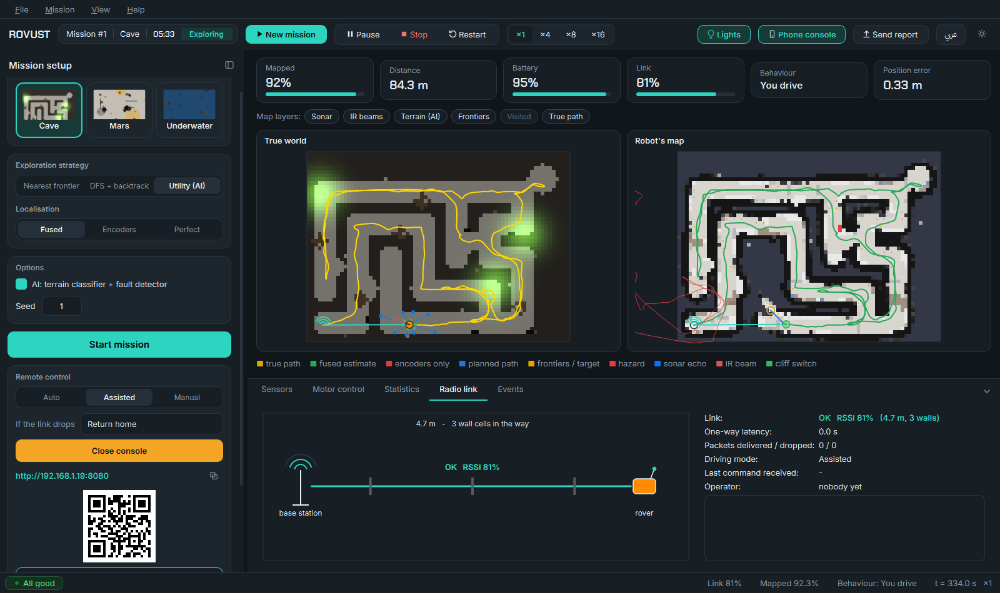
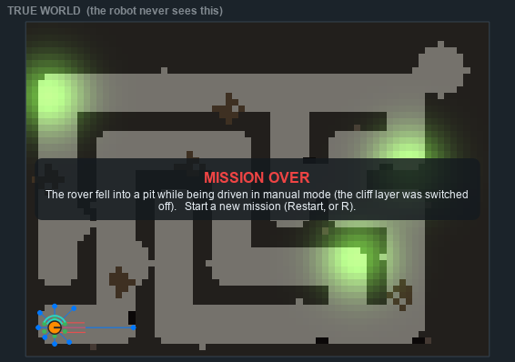
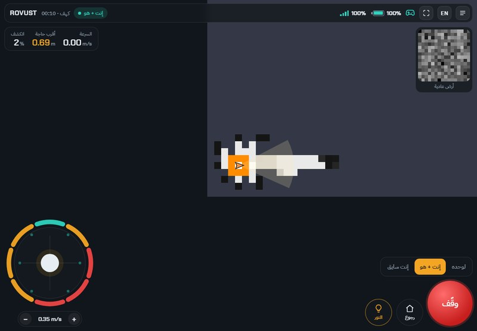
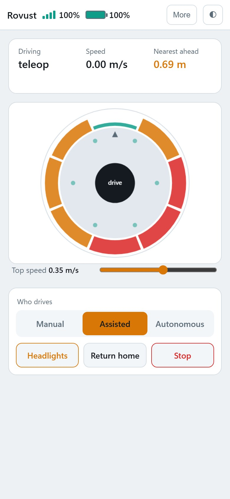
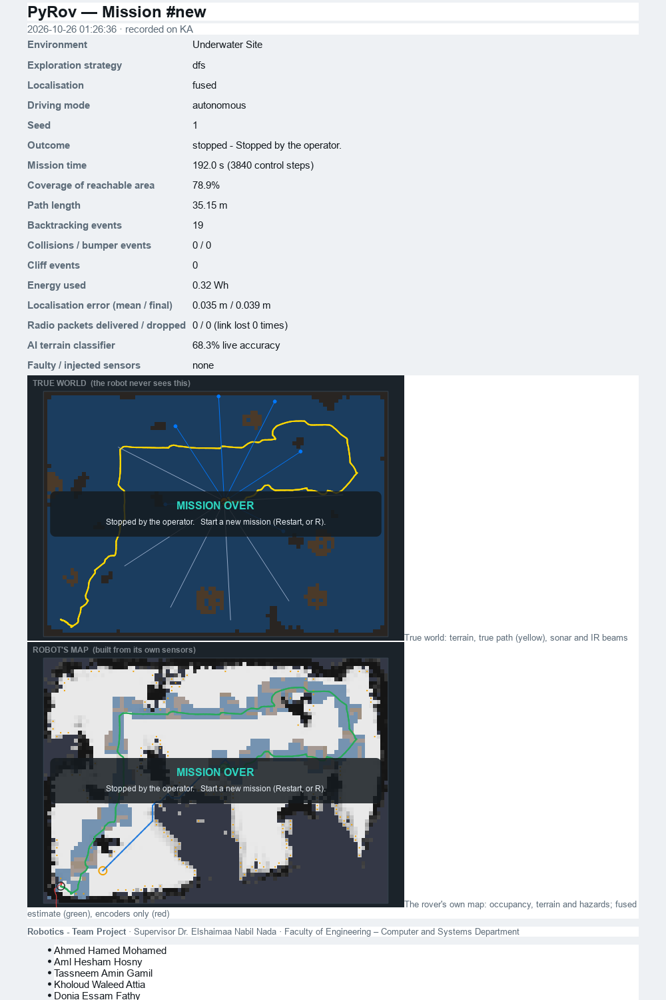
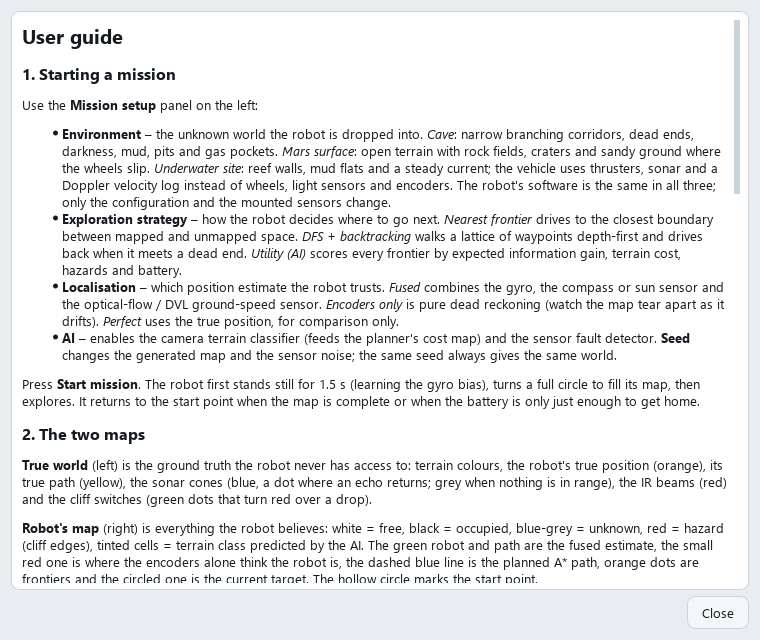

<p align="center">
  
</p>

<h1 align="center">PyRov</h1>
<p align="center"><b>Multi-Environment Autonomous Exploration Rover</b><br>
one robot, three unknown worlds — cave, Mars, underwater — simulated from the motors up</p>

<p align="center">
  
  
  
  
  
</p>

<p align="center">
  
</p>

PyRov drops a rover into a place it has never seen — no map, no GPS — and lets it
find its own way: it drives, senses, avoids walls and pits, builds a map, decides
where to go next and comes home before the battery runs out. The rover is
simulated **from the actuator level up** (DC motors, PWM, encoders, PID, a full
sensor suite) and the same robot runs unchanged in a cave, on Mars and under water.

## Highlights

- **Three environments, one robot.** Cave (maze corridors, darkness, mud, pits,
  gas), Mars (rocks, craters, sand with 25 % wheel slip, a sun sensor instead of
  a compass), underwater (reef, mud, a current, thrusters, sonar and a DVL).
  Only the configuration changes.
- **Built like the real thing.** Two DC motors behind an H-bridge with PWM,
  480-tick encoders, the lecture's discrete PID per wheel and a straight-driving
  controller; every sensor has its physics (sonar cone and specular loss, IR
  lookup-table calibration, gyro bias, cliff switches front/side/rear…), a 10-bit
  ADC, and can be **broken at run time with one click**.
- **It knows where it is.** Dead reckoning drifts metres; the fused estimate
  (gyro + compass/sun + optical flow/DVL) stays within centimetres — both are
  drawn live on the map.
- **Subsumption behaviours** (bumper escape › cliff stop › slope › avoid › …),
  A\* on an inflated cost map, and three exploration strategies: nearest frontier,
  DFS with backtracking, and a **utility explorer** that wins in every world.
- **AI where it earns its place.** A Random-Forest terrain classifier reads the
  camera and feeds the planner's cost map; a fault detector drops sensors that
  go bad; utility-based frontier selection.
- **Drive it yourself — from a phone or tablet.** Assisted mode (you steer, the
  safety layers still protect) or manual, over a **simulated radio link** that
  weakens with distance and walls, drops packets, adds Mars-like delay, and hands
  control back to the autonomy when it is lost.
- **A proper desktop app**, light and dark, with a user guide inside, a Radio
  link tab, clickable large maps, and **mission reports** (statistics + maps)
  uploaded to the team's shared Drive folder — queued when offline.
- **Measured, not assumed.** 264 headless runs compare strategies, localisation
  modes and sensor ablations — see [docs/RESULTS.md](docs/RESULTS.md).

## Screenshots

| Light mode — Mars, utility explorer | Dark mode — cave, driven from a phone, Radio link tab |
|---|---|
|  |  |
| **Motor control** — PWM → motor → encoder → PID, live | **Statistics** — coverage, path, errors, battery, AI accuracy |
|  |  |
| **Click a map** → large live view | **Mission over** — the reason, and what to do next |
|  |  |

| Phone / tablet console — tablet, dark | Phone, light (compact) | Mission report |
|---|---|---|
|  |  |  |

The joystick sits inside a ring of the rover's live sonar readings — the ring
turns amber and red where something is close, so you drive by feel.

<details>
<summary>User guide and About (inside the program)</summary>

| Help → User guide (F1) | Help → About |
|---|---|
|  |  |
</details>

## Quick start

**Windows, one click:** download [`setup.bat`](https://raw.githubusercontent.com/buggYateer/robotics-project/main/setup.bat)
(right-click → *Save link as…*) and double-click it. It finds or installs
Python, downloads the project where you choose, installs everything, puts a
**PyRov** shortcut on the desktop and starts the program. Run it again to update.

**By hand:**

```bash
git clone https://github.com/buggYateer/robotics-project.git
cd robotics-project
python -m venv .venv && .venv\Scripts\activate     # source .venv/bin/activate on Linux/macOS
pip install -r requirements.txt
python main.py
```

Then: pick an environment, a strategy and a localisation mode → **Start mission**.
`Space` pause · `1–4` speed · `R` restart · `Ctrl+S` send report · `F1` user guide.

**From a phone:** choose *Assisted* or *Manual* in **Remote control**, press
**Open console for phone / tablet**, open the address it shows in the phone's
browser (same Wi-Fi). Arrow keys / W A S D drive from the keyboard as well.

**Mission reports:** every finished mission (or **Send report**, which lets you
name the report) saves `reports/Mission #n - name/` with an HTML report and both maps, and
uploads it to the team's Drive folder; offline reports go out when the network
is back. Setup of the Drive bridge: [docs/DRIVE_REPORTS.md](docs/DRIVE_REPORTS.md).

> Python 3.12+ · Windows 11 with *Smart App Control* on may block compiled
> packages — turn it off or use Python 3.12. Using Claude Code? Paste the prompt
> in [docs/SETUP_WITH_CLAUDE.md](docs/SETUP_WITH_CLAUDE.md).

## What maps to the course

| Course topic | In PyRov |
|---|---|
| Actuators, PWM, H-bridge | `sim/robot/motor.py` — non-linear duty → speed, load, calibration table |
| Encoders, A/D | `encoder.py`, `sensors/base.py` — 2-phase incremental encoder, 10-bit ADC |
| Control (on-off, PID) | `robot/control.py`, `drive.py` — discrete PID, driving straight, `experiments/pid_demo.py` |
| Sensor types and placement | `sim/sensors/` — classification tags, physics, faults; [docs/DESIGN.md](docs/DESIGN.md) |
| Robot behaviour, subsumption | `behaviors.py` — nine prioritised layers, operator in the loop |
| Navigation, mapping, planning | `estimation.py`, `mapping.py`, `planning.py` |
| Communication | `comms.py`, `teleop/` — radio link model, operator console |
| AI | `sim/ai/` — terrain classifier, fault detector, utility explorer |

## Results in one glance

| | Cave | Mars | Underwater |
|---|---|---|---|
| Coverage after 400 s — utility explorer | **96 %** | **84 %** | **97 %** |
| … DFS + backtracking | 92 % | 72 % | 92 % |
| … nearest frontier | 69 % | 47 % | 65 % |
| Localisation error — fused / encoders only | 0.17 m / 2.4 m | 0.09 m / 3.7 m | 0.04 m / 5.5 m |

Killing the sonar collapses coverage to 5–25 %; killing the ground-speed sensor
puts the estimate 5–16 m off; killing the cliff switches cost one rover a
crater. Full tables and plots: [docs/RESULTS.md](docs/RESULTS.md).

```bash
pytest                                      # 49 tests
python -m sim.experiments.pid_demo          # step responses + calibration curve
python -m sim.experiments.run_batch --seeds 10            # strategies
python -m sim.experiments.run_batch --localisation        # fused vs encoders vs perfect
python -m sim.experiments.run_batch --ablation            # one sensor off at a time
```

## Documents

- [Proposal (Task 1)](docs/Task1_v2.md) · [Design notes & sensor placement](docs/DESIGN.md) · [Results](docs/RESULTS.md)
- [Drive reports bridge](docs/DRIVE_REPORTS.md) · [Setup with Claude](docs/SETUP_WITH_CLAUDE.md)
- **Presentation (30 slides):** [PowerPoint](docs/presentation/PyRov_presentation.pptx) · [PowerPoint with Egyptian-Arabic speaker notes](docs/presentation/PyRov_presentation_ar_notes.pptx) · [PDF](docs/presentation/PyRov_presentation.pdf) · [web viewer](docs/presentation/PyRov_presentation.html) (N = notes, L = EN/مصري) · [speaker notes](docs/presentation/SPEAKER_NOTES.md) — rebuilt with `python tools/build_presentation.py`
- [Promo trailer](docs/media/trailer.html) — 75 s animated page with an English voice-over spoken by the browser (open the file, press Play)
- **[دليل الفريق بالعربي (HTML تفاعلي)](docs/team_guide_ar.html)** — شرح كل جزء في المشروع وربطه بالمنهج وسيناريو العرض
- [رحلة بناء المشروع](docs/JOURNEY_ar.md) — الأفكار والمشاكل والإصلاحات بالترتيب

## Team

Robotics — team project, Faculty of Engineering, Computer and Systems Department.
Supervisor: **Dr. Elshaimaa Nabil Nada**.

Ahmed Hamed Mohamed · Aml Hesham Hosny · Tassneem Amin Gamil · Kholoud Waleed Attia ·
Donia Essam Fathy · Mazen Mohamed Hussien · Mohamed Osama Salah · Mohamed Elsayed Mohamed ·
Mahmoud Ahmed Abdelghani
