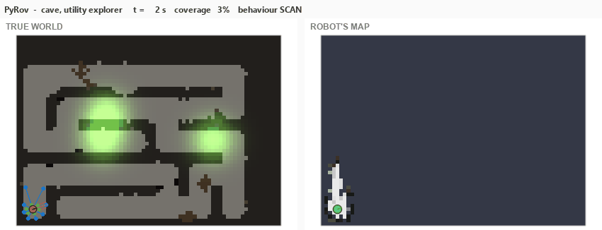
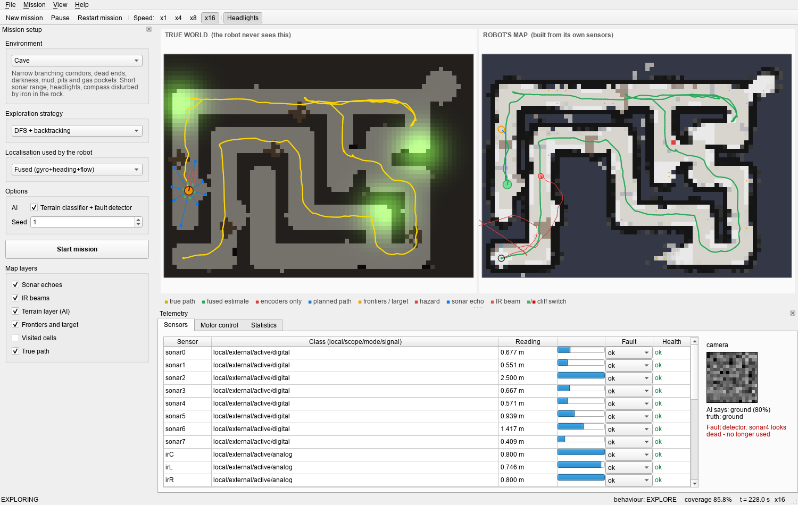
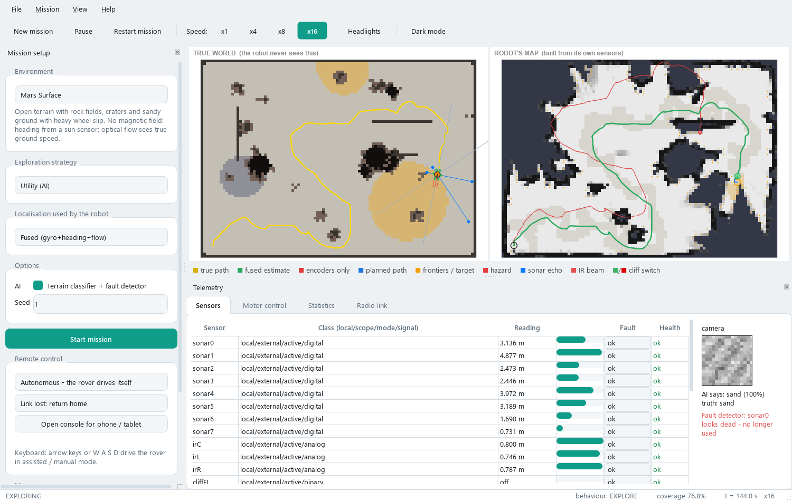
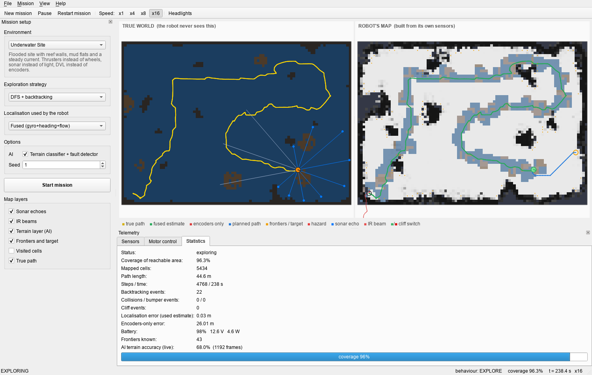
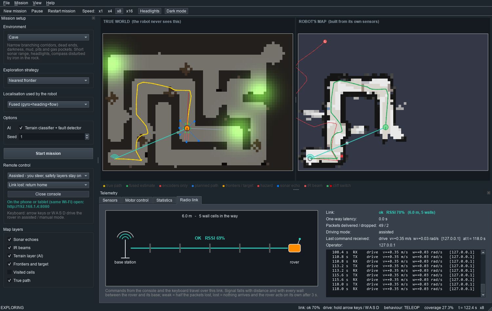

<p align="center">
  
</p>

<h1 align="center">PyRov</h1>
<p align="center"><b>Multi-Environment Autonomous Exploration Rover</b><br>
one robot, three unknown worlds — cave, Mars, underwater — simulated from the motors up</p>

<p align="center">
  
  
  
  
  
</p>

<p align="center">
  
</p>

A Python simulation of an autonomous exploration rover, built **from the actuator
and sensor level up** — DC motors, PWM, encoders, PID, a full on-board sensor
suite — to localisation, mapping, exploration and AI terrain classification.
One robot, three selectable environments: **cave**, **Mars surface**,
**underwater site**. Each environment is only a configuration (map generator,
terrain, sensor suite, noise, slip, current); the robot's control, estimation
and decision code never changes.

Robotics course — team project, supervised by **Dr. Elshaimaa Nabil Nada**.
Full proposal: [docs/Task1_v2.md](docs/Task1_v2.md). Design notes and sensor
placement: [docs/DESIGN.md](docs/DESIGN.md). Experimental results:
[docs/RESULTS.md](docs/RESULTS.md).

## How to run

### One-click (Windows)

1. Download [`setup.bat`](https://raw.githubusercontent.com/buggYateer/robotics-project/main/setup.bat)
   (right-click → *Save link as…*) and double-click it.
2. It asks where to put the project (Enter = `C:\Users\<you>\PyRov`), finds or
   installs Python, downloads the project, installs everything, puts a **PyRov**
   shortcut on the desktop and starts the program. Run it again later to update.
3. Next time: double-click the **PyRov** desktop shortcut, or `run.bat` in the
   project folder.

Or, in PowerShell, one line:

```powershell
irm https://raw.githubusercontent.com/buggYateer/robotics-project/main/setup.ps1 | iex
```

Using Claude Code instead? Paste the prompt in [docs/SETUP_WITH_CLAUDE.md](docs/SETUP_WITH_CLAUDE.md).

### By hand

**Requirements:** Python 3.12 or newer (we use 3.15), Git, Windows / Linux / macOS.

1. Get the code
   ```bash
   git clone https://github.com/buggYateer/robotics-project.git
   cd robotics-project
   ```
2. Create a virtual environment and install the dependencies (once)
   ```bash
   python -m venv .venv
   .venv\Scripts\activate            # Windows
   source .venv/bin/activate         # Linux / macOS
   pip install -r requirements.txt
   ```
3. Run the simulator
   ```bash
   python main.py
   ```
   A desktop window opens. In the **Mission setup** panel on the left choose
   the environment, the exploration strategy, the localisation mode, AI on/off
   and a seed, then press **Start mission**. The **Help → User guide** menu
   inside the program explains every panel; **Help → About** has the team.

   Keyboard: `Space` pause · `1 2 3 4` speed ×1 ×4 ×8 ×16 · `R` restart · `H`
   headlights · `F1` user guide. In the **Sensors** tab the *Fault* column
   injects a fault into any sensor while the mission runs.

4. (optional) Run the tests and the experiments
   ```bash
   pytest
   python -m sim.experiments.pid_demo
   python -m sim.experiments.run_batch --seeds 10
   ```

5. (optional) Drive the rover yourself from a phone or tablet
   - In **Remote control** choose *Assisted* (you steer, the safety layers stay
     on) or *Manual* (nothing stops you), then press **Open console for phone /
     tablet**. The panel shows an address such as `http://192.168.1.4:8080`.
   - On a phone or tablet connected to the **same Wi-Fi**, open that address in
     the browser. The console works in landscape (joystick left, telemetry
     right) and portrait, has a light / dark switch, and shows the rover's
     sonar ring around the joystick, its camera, map, link and battery.
   - Driving commands travel over a simulated radio link: it weakens with
     distance and walls (cave), carries a 2 s delay (Mars) or 0.4 s
     (underwater acoustic modem), drops packets when weak, and when lost for
     3 s the rover returns home by default (or explores alone / waits — your
     choice in *Link lost*). The **Radio link** tab shows the signal, the walls
     in the way, latency, packet counters and a live log of what arrives from
     the phone. Console settings (who drives, top speed) apply at once; only
     physical commands go over the radio.
   - Arrow keys / W A S D drive from the computer's keyboard as well: start a
     mission, choose Assisted or Manual, then *hold* a key.
   - If Windows asks, allow Python through the firewall on private networks.

`python main.py --pygame` starts the older single-window Pygame interface.

> **Windows 11 note:** if *Smart App Control* is on, the compiled parts of
> matplotlib / scikit-learn / PySide6 may be blocked ("An Application Control
> policy has blocked this file"). Turn it off in *Windows Security → App &
> browser control*, or use Python 3.12 whose packages are already trusted.

## Screenshots

| Cave – Sensors tab | Mars – Motor control tab |
|---|---|
|  |  |
| **Underwater – Statistics tab** | **Radio link tab while driving from a phone (dark mode)** |
|  |  |

Left map: the true world the robot never sees (sonar cones, IR beams, cliff
switches, true path). Right map: the robot's own map (occupancy + terrain +
hazards, fused estimate in green, encoders-only estimate in red, planned path,
frontiers). Bottom tabs: every sensor reading live with fault injection, the
PWM → motor → encoder → PID loop, and the mission statistics.


## What is simulated

| Layer | What the code does | Course topic |
|---|---|---|
| **Actuators** (`sim/robot/motor.py`) | Two DC motors behind an H-bridge; PWM duty → non-linear effective voltage with a static-friction dead band; first-order mechanical response; load from terrain; a `calibration_table()` that measures duty → speed | Actuators 1 & 2 |
| **Encoders** (`encoder.py`) | 16-tick two-phase incremental encoder on the motor shaft (×30 gearbox = 480 ticks/wheel rev), direction from phase order, speed from tick delta (quantised) | Sensors 1 |
| **Control** (`control.py`, `drive.py`) | On-off, hysteresis, P, PI, PD, PID in the lecture's incremental discrete form; a PID velocity loop per wheel; an I-controller on the encoder *position* difference so the differential drive goes straight; wheel slip the encoders cannot see | Control |
| **Sensors** (`sim/sensors/`) | Sonar ring (cone, specular loss, cross-talk, time-of-flight), Sharp-style IR PSDs (non-linear, lookup-table calibration, minimum-range fold-back), IR cliff switches (front, side, rear), bumpers, compass with local disturbance, sun sensor, gyro with bias, accelerometer/inclinometer, camera, optical flow / DVL, battery, light, gas, pressure. Analog sensors pass a modelled 10-bit **A/D converter**. Every sensor can be faulted at run time. | Sensors 1 & 2 |
| **Localisation** (`estimation.py`) | Dead reckoning from the encoders (drifts); fused estimate: gyro integrated and corrected by compass/sun (complementary filter, bias learned while stationary) + ground speed from optical flow / DVL | Sensors 2 |
| **Mapping** (`mapping.py`) | Log-odds occupancy grid (one echo never makes a cell occupied), terrain-cost layer from the AI, hazard layer from the cliff sensors | Navigation |
| **Behaviour** (`behaviors.py`) | Subsumption: `STOP > ESCAPE (bumper) > CLIFF > SLOPE > SCAN > AVOID (with hysteresis) > TELEOP (operator) > HOME (battery) > EXPLORE > WANDER` | Robot Behaviour |
| **Communication** (`comms.py`, `teleop/`) | Radio link to a base station at the start point: signal vs distance and walls, packet loss, latency, watchdog, fallback to autonomy; phone/tablet console served over Wi-Fi; Radio link tab | Robot Behaviour (communication) |
| **Planning** (`planning.py`) | A* on an inflated cost map (configuration space + proximity penalty + terrain cost); nearest-frontier vs DFS-with-backtracking exploration; return to start when the battery only just suffices | Navigation / decision |
| **AI** (`sim/ai/`) | Random-Forest terrain classifier on 16×16 camera patches → planner cost map; sensor fault detector (stuck / dead / noisy) that drops a bad sensor; utility-based frontier selection (information gain / cost − hazard − battery) | — |
| **Environments** (`config.py`, `world.py`) | Cave: maze corridors, chambers, mud, pits against the walls, gas pockets, darkness. Mars: rock fields, craters with rims and slopes, sand (25 % slip), bedrock, ridges. Underwater: cellular-automata reef, mud flats, a constant current with noise. | — |

## Experiments (headless)

```bash
python -m sim.experiments.pid_demo                       # step responses of on-off/hysteresis/P/PI/PID + calibration curve
python -m sim.experiments.run_batch --seeds 10           # frontier vs DFS vs utility, every environment
python -m sim.experiments.run_batch --localisation       # fused vs encoders-only vs perfect
python -m sim.experiments.run_batch --ablation           # switch each sensor off and measure the damage
```

Each batch writes `results/<name>.csv` plus `<name>_summary.png` (coverage,
path length, backtracking, bumps, localisation error, energy) and
`<name>_coverage.png` (coverage over time, mean ± std over seeds).

## Tests

```bash
pytest
```

41 tests cover the motor calibration curve, encoder direction, PID steady-state
error, driving straight with mismatched motors, world connectivity, every
sensor's physics and faults, dead reckoning vs fusion, occupancy-grid
precision, A*, frontier detection, mission runs in all environments,
subsumption priorities, return-home, the terrain classifier and the fault detector.

## Layout

```
main.py                 entry point (Pygame app)
sim/config.py           environment configurations (the only thing that changes per environment)
sim/core.py             Pose, angles, terrain table
sim/world.py            true world + generators (cave / mars / underwater)
sim/robot/              motor, encoder, control, differential drive, robot body + battery
sim/sensors/            sensor base (classification, ADC, faults), range sensors, internal sensors, camera, suite
sim/estimation.py       dead reckoning, heading fusion
sim/mapping.py          occupancy grid + mapper
sim/planning.py         cost map, A*, frontiers, Frontier/DFS explorers
sim/behaviors.py        subsumption layers + arbiter
sim/mission.py          one run: wires everything, metrics
sim/ai/                 terrain classifier, fault detector, utility explorer, brain
sim/ui/                 menu, About, live simulator
sim/experiments/        batch runner, plots, PID demo
tests/                  pytest suite
docs/                   proposal (Task 1) and design notes
```
