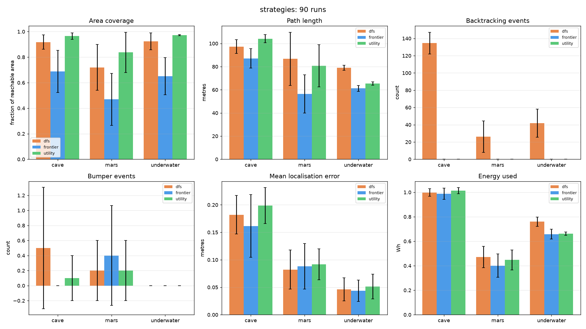
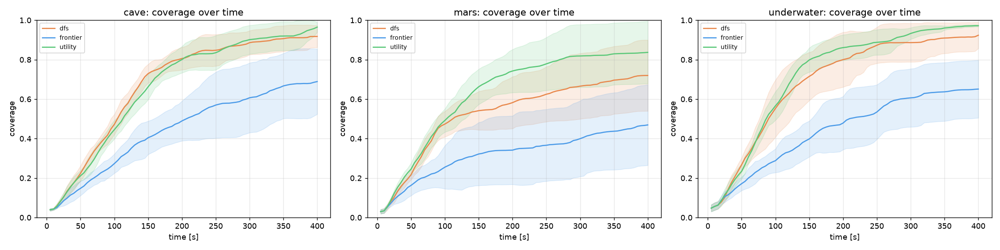
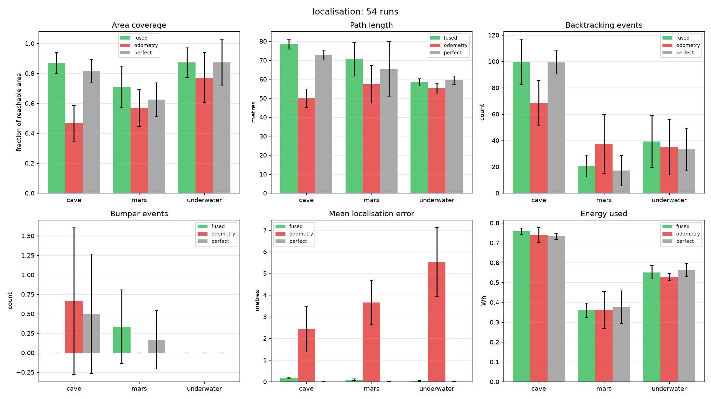
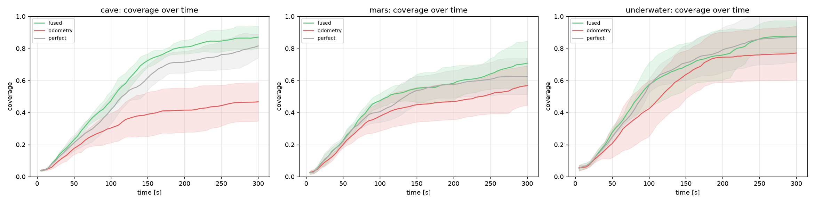
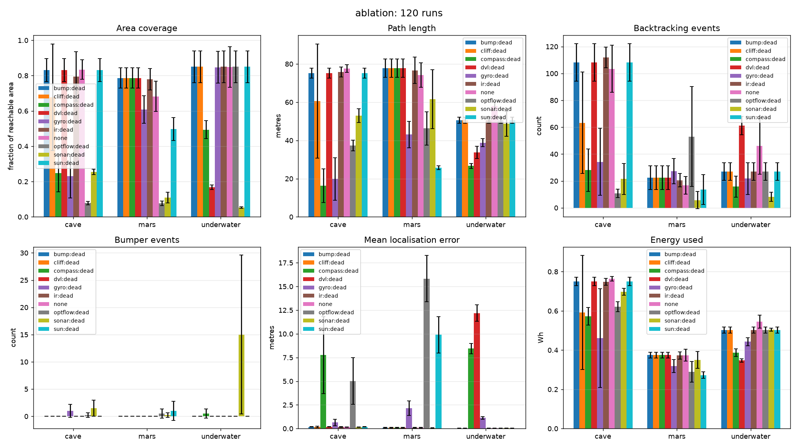
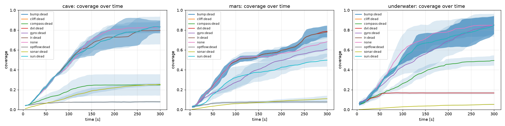
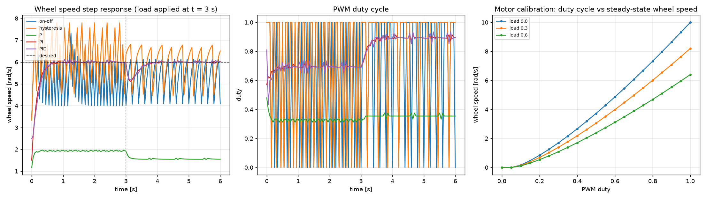

# Experimental results

All runs use the same robot code; only the environment configuration, the
exploration strategy, the localisation mode or the injected fault changes.
Each run lasts at most 400 s of simulated time (8000 control steps of 50 ms)
for the strategy experiment and 300 s for the others, or ends earlier when the
robot returns home, falls into a pit or empties its battery. Numbers are
mean ± standard deviation over seeds; every seed is a different generated map
and a different noise sequence. Reproduce with:

```bash
python -m sim.experiments.run_batch --seeds 10            # strategies
python -m sim.experiments.run_batch --localisation --seeds 6
python -m sim.experiments.run_batch --ablation --seeds 4
python -m sim.experiments.pid_demo
```

## 1. Exploration strategy (90 runs, 10 seeds)

Hypothesis from the proposal: *nearest-frontier covers more area with fewer
steps in open environments (Mars); DFS with backtracking performs well in
corridor-like environments (cave).*

| Environment | Strategy | Coverage (400 s) | Path [m] | Backtracks | Bumps | Loc. error [m] |
|---|---|---|---|---|---|---|
| Cave | DFS + backtracking | 0.92 ± 0.06 | 97 ± 6 | 135 | 0.5 | 0.18 |
| Cave | Nearest frontier | 0.69 ± 0.17 | 87 ± 8 | 0 | 0.0 | 0.16 |
| Cave | **Utility (AI)** | **0.96 ± 0.03** | 104 ± 4 | 0 | 0.1 | 0.20 |
| Mars | DFS + backtracking | 0.72 ± 0.18 | 87 ± 23 | 26 | 0.2 | 0.08 |
| Mars | Nearest frontier | 0.47 ± 0.20 | 56 ± 17 | 0 | 0.4 | 0.09 |
| Mars | **Utility (AI)** | **0.84 ± 0.16** | 81 ± 18 | 0 | 0.2 | 0.09 |
| Underwater | DFS + backtracking | 0.92 ± 0.07 | 79 ± 2 | 42 | 0.0 | 0.05 |
| Underwater | Nearest frontier | 0.65 ± 0.15 | 61 ± 2 | 0 | 0.0 | 0.04 |
| Underwater | **Utility (AI)** | **0.97 ± 0.00** | 65 ± 1 | 0 | 0.0 | 0.05 |




**Findings**

* The second half of the hypothesis holds: DFS with backtracking is strong in
  the cave (92 %), where corridors funnel the search and every dead end costs
  one backtracking event (135 per run).
* The first half does **not** hold: plain nearest-frontier is the weakest
  strategy everywhere, including open terrain (47 % on Mars). Greedy
  nearest-first chases many tiny frontiers near rocks, revisits the same
  region and leaves large unknown areas for later.
* The utility explorer — information gain divided by terrain-weighted path
  cost, minus hazard and battery penalties — is the best strategy in all
  three environments (96 / 84 / 97 %) with no backtracking events and with
  a path length comparable to DFS. The benefit is largest exactly where the
  proposal expected frontier methods to shine: open terrain.
* No robot fell into a pit in any of the 90 runs; bumper events are below one
  per run in every configuration (the subsumption layers do their job).
* Localisation error does not depend on the strategy (0.04–0.20 m), as
  expected: it is a property of the sensor fusion, not of the planner.

## 2. Localisation (54 runs, 6 seeds, DFS strategy, 300 s)

What the robot *uses* as its position: the fused estimate (gyro + compass or
sun sensor + optical flow / DVL), the encoders alone (dead reckoning), or
the true position (upper bound).

| Environment | Estimate used | Coverage | Mean error [m] | Final error [m] | Bumps |
|---|---|---|---|---|---|
| Cave | Fused | 0.87 ± 0.07 | 0.17 | 0.18 | 0.0 |
| Cave | Encoders only | 0.47 ± 0.12 | 2.43 | 4.51 | 0.7 |
| Cave | Perfect | 0.82 ± 0.07 | 0 | 0 | 0.5 |
| Mars | Fused | 0.71 ± 0.14 | 0.09 | 0.13 | 0.3 |
| Mars | Encoders only | 0.57 ± 0.12 | 3.65 | 6.17 | 0.0 |
| Mars | Perfect | 0.62 ± 0.11 | 0 | 0 | 0.2 |
| Underwater | Fused | 0.87 ± 0.10 | 0.04 | 0.04 | 0.0 |
| Underwater | Encoders only | 0.77 ± 0.17 | 5.52 | 6.86 | 0.0 |
| Underwater | Perfect | 0.87 ± 0.16 | 0 | 0 | 0.0 |




**Findings**

* Dead reckoning from the encoders alone drifts by 2.4 m (cave, mud slip and
  disturbed compass unused), 3.7 m (Mars, 25 % slip in sand) and 5.5 m
  (underwater, thrusters have no ground contact at all) over a five-minute
  run — the "errors are cumulative and the robot soon loses its bearings" of
  the lecture, measured.
* The fused estimate stays within 4–17 cm. It explores as well as a robot
  with perfect knowledge of its position (the differences between *fused*
  and *perfect* are inside one standard deviation), so the remaining error
  does not limit the mission.
* The cost of drift is largest in the cave: with encoders only the map tears
  apart, walls are duplicated, the planner finds no way through, and coverage
  halves (47 % vs 87 %). In open terrain the map is more forgiving.
* The heading reference matters more than the position sensor: a gyro bias
  of 0.006 rad/s alone would rotate the map by 20° per minute; the compass
  (cave, underwater) and the sun sensor (Mars) bound it.

## 3. Sensor ablation (120 runs, 4 seeds, DFS strategy, 300 s)

Each run kills one sensor group at the start (`dead`: it reports nothing) and
the mission continues with the rest. A fault on a sensor the environment does
not mount (e.g. the sun sensor in the cave) is the control: it must change
nothing, and it does not.

| Dead sensor | Cave coverage | Cave loc. err. [m] | Mars coverage | Mars loc. err. [m] | Underwater coverage | Underwater loc. err. [m] |
|---|---|---|---|---|---|---|
| none (baseline) | 0.83 | 0.15 | 0.68 | 0.09 | 0.85 | 0.04 |
| **sonar ring** | **0.25** | 0.14 | **0.11** | 0.07 | **0.05** (15 bumps) | 0.05 |
| IR PSDs | 0.80 | 0.16 | 0.78 | 0.09 | – (not mounted) | – |
| cliff switches | 0.68, **1 fall** | 0.16 | 0.79 | 0.09 | – | – |
| bumpers | 0.83 | 0.19 | 0.79 | 0.09 | 0.85 | 0.03 |
| gyro | 0.23 | 0.64 | 0.61 | 2.15 | 0.85 | 1.12 |
| compass | 0.25 | **7.75** | – | – | 0.49 | **8.45** |
| sun sensor | – | – | 0.50 | **9.90** | – | – |
| optical flow | **0.08** | **5.02** | **0.08** | **15.8** | – | – |
| DVL | – | – | – | – | **0.17** | **12.2** |




**Findings**

* **The sonar ring is the mapping sensor.** Without it the robot still
  survives (the IRs and bumpers keep it off the walls) but it cannot see far
  enough to map: coverage collapses to 5–25 %, and underwater — where there
  are no IRs — it bumps into the reef 15 times per run.
* **The ground-speed sensor is the localisation sensor.** Without optical
  flow (cave, Mars) or the DVL (underwater) the fused estimate falls back on
  the encoders and drifts 5–16 m; the map becomes useless and coverage drops
  to 8–17 %. Wheel slip in sand and mud is that large.
* **An absolute heading reference is indispensable.** Killing the compass
  (cave, underwater) or the sun sensor (Mars) leaves the gyro alone; its bias
  turns the whole map by tens of degrees and the position error reaches 8–10 m.
  Killing the gyro instead is milder (0.6–2 m) because the compass still
  bounds the heading, but the heading becomes noisy and coverage suffers in
  the cave's narrow corridors.
* **The cliff switches are the only thing between the robot and a crater.**
  With them dead, one of four cave runs ended in a pit. In the Mars runs the
  SLOPE behaviour (accelerometer) happened to keep the rover off the crater
  rims, which is why a second, independent protection exists.
* **IR PSDs and bumpers are redundant with the sonar** in these runs: losing
  them costs almost nothing, because the sonar ring already sees the walls
  and the avoidance layer keeps the body clear. They earn their place on the
  robot as the last line of defence, not as the primary sensors.
* Faults on sensors that are not mounted (sun sensor in the cave, compass on
  Mars, DVL on land, optical flow underwater) reproduce the baseline exactly,
  which confirms that the harness injects faults where it should.

## 4. Motor control (PID demo)



* On-off control oscillates by ±1 rad/s around the set-point and the
  hysteresis band widens the oscillation while lowering the switching rate.
* The P controller settles with a large steady-state error (2 rad/s for a
  6 rad/s target) because its output goes to zero when the error does.
* PI and PID remove the steady-state error and recover from the load step at
  t = 3 s (a hill: 50 % extra load) in under a second.
* The calibration curve (right) shows the PWM duty → speed relation is not
  linear and drops with load, which is why closed-loop control is needed in
  the first place.
